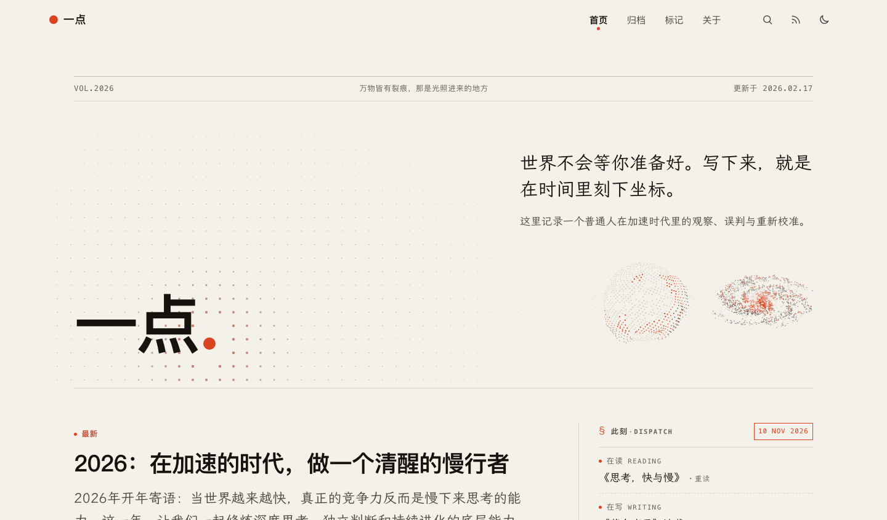
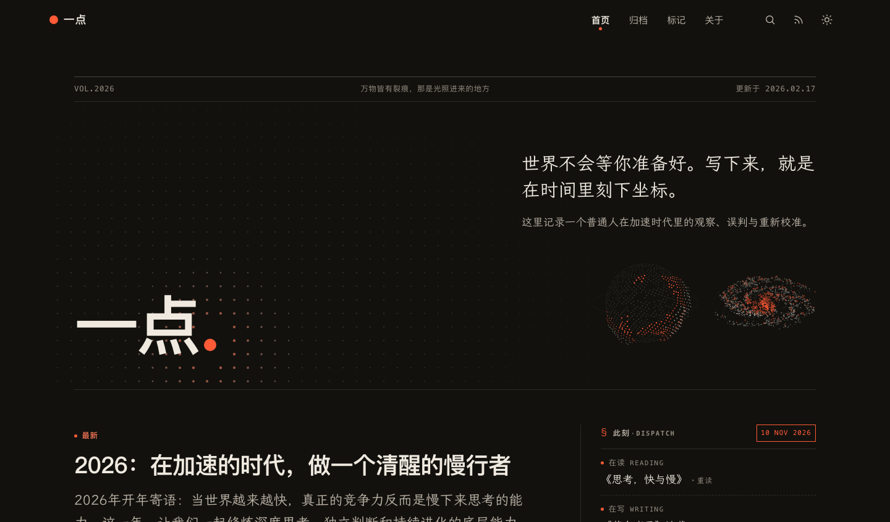

# 一点 · 独立写作

> 一个人的编辑部。世界不会等你准备好——写下来，就是在时间里刻下坐标。

个人站点：随笔、小说、独立应用，都放在同一张纸上。

线上地址 <https://yakoxff.pages.dev> ｜ 作者 [Yak](https://yakoxff.pages.dev/about/) ｜ 重构记录 [REFACTOR.md](REFACTOR.md)



---

## 目录

- [站内有什么](#站内有什么)
- [技术构成](#技术构成)
- [设计：V10「一点」](#设计v10一点)
- [目录结构](#目录结构)
- [本地开发](#本地开发)
- [写作](#写作)
- [构建与部署](#构建与部署)
- [性能基线](#性能基线)
- [已知限制](#已知限制)
- [许可](#许可)

## 站内有什么

| 栏目 | 路径 | 内容 |
|---|---|---|
| 随笔 | `/posts/` | 24 篇：技术、认知、生活观察 |
| 虚构 | `/fictions/` | 2 部连载、26 章：目录即书名，一章一个文件 |
| 关于 | `/about/` | 写作年轮（一圈一年）、DOT / MOTION 点阵动效插页、版权页、鸣谢、在别处 |
| 标记 | `/highlights/` | 主导航栏目。8 篇 / 36 句，按来源文章分组；`==高亮==` 由脚本汇总，JSON 已入库 |
| 精选 | `/featured/` | 自选的一批文章 |
| 赞助 | `/sponsor/` | 支持创作，页内实时统计篇数与字数 |
| 标签 | `/tags/` | 主题总览 + 站内搜索（搜索索引见[已知限制](#已知限制)） |
| RSS | `/index.xml` | Atom 与 RSS 共用一份，另有 `/rss/` 这页人读的说明 |

中文单语。Hugo 统计 207 个页面、117 个静态文件，落到磁盘是 138 个 HTML（其余是 RSS、sitemap、重定向别名页）。另有 `/blank/` 一页，`layout: blank`，真的什么都没放。

## 技术构成

| 层 | 用什么 | 说明 |
|---|---|---|
| 生成器 | Hugo 0.150 extended | 模板 + Hugo Pipes：Sass 编译、minify、fingerprint + SRI |
| 样式 | SCSS + UnoCSS | 设计令牌在 `assets/css/v10/_tokens.scss`；UnoCSS 只为模板里真正出现的原子类产出 CSS（当前 618 条） |
| 脚本 | 原生 JavaScript，无框架 | 首页涟漪场（canvas）、阅读页（读程 / 摘句 / 偏好）、主题切换、评论与目录抽屉 |
| 字体 | 系统宋体正文 / 系统黑体标题，零字体下载 | 见[字体](#字体) |
| 评论 | giscus | GitHub Discussions，配自建无边框主题 `static/css/giscus_noborder.css` |
| 统计 | Umami | 只在 `production` 注入，本地预览不请求线上统计 |
| 部署 | Cloudflare Pages + GitHub Pages | `static/_headers` 是 Pages 的缓存 / CSP 配置，GitHub Pages 会忽略 |

没有前端框架、没有打包器、没有运行时依赖——一条 `hugo` 命令就能出整站。

## 设计：V10「一点」

整套视觉只有一个品牌原子：**点**。站名从「一点记」收敛成「一点」，单枚朱砂点继续做导航当前项、列表游标、阅读进度珠、焦点环、文末句点；顶栏 logo 与首页刊头的句点也是一枚**实心纯色朱砂圆**（V10.16 起不再用按栏目变形的点阵形状）。其余交给纸与墨：不加满屏卡片，用字号、字重、粗细线建立层级。

品牌点统一取 `--zhu`，明暗主题自动跟随：顶栏 14px、刊头 `.19em`（跟着 h1 字号缩放）、此刻公报落款 8px，都是纯色实心圆；刊头那枚同时是首页涟漪场的波心。`layouts/_partials/components/dot-shape.html`（5×5 点阵形状）文件保留但当前无引用，想恢复某处的点阵形状，把对应 span 换回 partial 调用即可。

眉题前那枚 `.v-dot` 只有 `0.42em`，同样是实心圆；文末「全文完」的「一 + 、」笔墨标记是手写笔触，属于另一套语言。

| 令牌 | 明色 | 暗色 | 用途 |
|---|---|---|---|
| `--paper` | `#f4f1ea` | `#12110e` | 底色，偏暖的书页白 |
| `--ink` | `#16130f` | `#efe9df` | 标题与正文 |
| `--zhu` | `#d9431f` | `#ff5b36` | 朱砂点，只用于「点」与色块，不承载小字 |
| `--mark-strong` | `#9e3a2c` | — | 正文加粗（7.0:1） |
| `--mark-em` | `#4f6a3e` | — | 正文强调（5.9:1） |

暗色不是把明色反过来，而是换成夜里的纸：底色压到 `#12110e`，朱砂提亮到 `#ff5b36` 以免在深底上发闷，正文对比度仍保持 16.1:1。



三种字体角色分工：标题走 `--font-display`（系统黑体），正文走 `--font-read`（系统宋体栈），数字 / 眉题走 `--font-num`（等宽）。正文之外的界面文字一律用系统 UI 字体。全站零字体下载，见[字体](#字体)。

- **首页**：刊头是一块 canvas 涟漪点阵场——朱砂点像一滴墨落进水面，波前经过的点被点亮并沿径向推开；指针靠近会亮起，点击能激起新的涟漪。`prefers-reduced-motion` 下只画一帧静态晕圈，画面静止 600ms 后停表。头条（最新 / 精选）下方还有两篇「次条」，只给标题与日期、阅读时长，不显示摘要，且会先从「最近发表」的时间序里扣掉，避免重复。
- **刊头右侧**：不再重复「文章 / 主题 / 万字」（「此刻 → 在发」已有篇数和字数），水平并排放两颗独立点阵图（整体靠栏目右侧，潮汐因此向左让出位置）。左为「潮汐之境」点云球——2000 枚点按 Fibonacci 球面分布，多层噪声长出朱砂群岛，缓慢自转，入场时从海面往上生长，点一下荡开两圈潮汐；右为「夜航星海」星盘——1800 点铺成四条对数旋臂的倾斜盘面，内快外慢差速自转、逐颗闪烁，点击荡开椭圆回响。两颗各一块 canvas、各自内联 JS（30fps 节流、不可见停表），颜色读站点令牌跟随明暗，`prefers-reduced-motion` 下都只画一帧。原型分别取自 DOT / WORLD 的 *TIDAL ARCHIPELAGO* 与 *THE INFINITE GARDEN*，见 `assets/js/tide.js` / `galaxy.js`。全视口保持水平并排，≤860px 时两颗等比缩到 `clamp(108px, 32vw, 140px)`，避免溢出与首屏被拉空。
- **按主题读**：三栏一行，每栏一个主题三篇。先挑没被头条与「最近发表」用掉的文章，不够再回补，所以三栏始终填满。
- **虚构书页**：首页编号 03 的区块，两部连载各一张书页卡片——卷号、状态印、楷体书名、一句简介、最近三章的点线目录与「共 N 章 · 读全书」。数据直接读 `content/fictions` 下各部的 `_index.md` 与章节 front matter，不另建数据文件；窄屏改为上下竖排。
- **此刻**：头条右侧栏里的「状态公报」——细线分栏、等宽标签、朱砂点、日期框、底部排印说明，四行「在读 / 在写 / 在发 / 在码」，字号比头条低一档，不抢刊头。后两行从站点内容自动算出（篇数、字数、最近更新、近 12 个月发文柱图），不会写完就过期。见[维护此刻状态](#维护此刻状态)。
- **分隔线**：全站统一 1px 半透明 `--line-2`（明暗各 24% 墨 / 纸色）。原 `--line-ink` 纯墨纯白的 2px 强线与 `3px double` 双线已废弃；只有引用块、朱砂强调这类竖向装饰保留粗线。
- **阅读页**：「一章书页」——宽版排版（外壳与首页同宽 1200px，正文最多 980px）、居中扉页（V10.19 起只留标题与紧凑账页：简介下线、标题字号回调、上下留白与装饰线一并收紧；V10.20 账页改为「标签 + 值」横铺一行、去掉上下框线、Aa 收小；V10.22 标题行宽收回与正文同宽的 `--rd-measure`、长标题用 `balance` 配平，不再顶到右侧目录）、首字下沉、图片外扩出血；右页边点线目录的章节名常显（≥1100px），当前章朱砂加粗，窄屏改底部胶囊；V10.26 起目录整体右移、宽屏有目录时图片不再向右侧出血；V10.27 起章节条目完全紧挨成一簇，进度线与朱砂珠同步缩短到簇高，避免宽图压住章节名。选中文字浮出「复制摘句 / 分享」，文末「全文完」并给出实际用时。
- **正文排版**：统一用项目自带的霞鹜文楷（不另引字体），18px / 行距 1.85 / 段距 1.05em，取消 `text-align: justify + inter-character` 逐字拉伸（旧版中文字距忽宽忽窄）。朱砂收敛到 h2 编号、h3 小点、列表圆点、首字下沉、引用细线与分隔线中点；`strong` 改深墨加粗 + 淡朱砂底线，`em` 用中文着重号。引用块淡纸底 + 朱砂细线（线头一枚实心朱砂点，不用引号字符），代码块与表格统一细线，分隔线是「细线 + 一枚朱砂点」；旧版 markdown 漏进来的行内代码反引号、链接站点图标、竖排语言标签、表头底色全部清掉。
- **无障碍**：所有动效尊重 `prefers-reduced-motion`；正文级对比度按 WCAG AA 实算；读程 / 评论 / 目录按钮的展开状态同步 `aria-expanded`。
- **分享与 SEO**：`head/siteinfo.html` 统一输出 title / canonical / description / OG / Twitter Card / JSON-LD；标题在非首页带站点名，描述按 `answer` → `description` → `Description` → `Summary` → 站点描述的优先链取并截断到 160 字。分享图优先用 `og_image` / `banner`，否则用 `static/share/og-card-v4.png`（1200×630，可用 `scripts/gen-og-image.py` 重生成）。文件名带版本号、放在独立的 `share/` 目录，是因为 X 按图片 URL 长期缓存卡片且 `_headers` 给 `/img/*` 设了 30 天缓存——换内容必须换 URL 才会被重新抓取。JSON-LD 按首页 `WebSite` / 文章 `BlogPosting` / 独立页 `WebPage` / 列表 `CollectionPage` 分流，全部走 `jsonify` 保证合法；`robots.txt` 默认放行并允许各类预览抓取器，只拦 AI 爬虫。文章页的「分享」按钮在桌面降级为复制「标题 + 摘要 + 链接」。
- **GEO / AI 可引用**：`static/robots.txt` 放行全部 AI 代理（GPTBot / OAI-SearchBot / ChatGPT-User / ClaudeBot / Claude-User / PerplexityBot / Google-Extended 等）并声明 `Content-Signal: ai-train=yes, search=yes, ai-input=yes`；Hugo 自动生成 `llms.txt`（结构化索引 + 常见问题答案式入口）与 `llms-full.txt`（纯文本全文），新增文章自动进入索引；每页 JSON-LD 输出主对象 + `BreadcrumbList`，文章补 `isAccessibleForFree` / `license` / `about`；三页带 `answer` 一句话直接答案；全站 52 张图的 alt 均改为传达图中信息的描述。
- **重生第一篇**：`content/posts/付印之前：三十九道红笔.md` 是站点的设计编年长文，按 V10 → V10.25 复盘每一轮的取舍、前后数字与令牌 / 网格 / 内容 / 缓存四层底层规则，附完整编年表与 10 张配图（真实前后对比、手绘 SVG 示意、生成插画，均在 `static/img/rebirth/`）。
- **品牌长文**：`content/posts/一笔，一枚点：为什么最后叫「一点」.md` 从「一点记」到「一点」的命名收敛、符号四次演变讲起，落到令牌 / 网格 / 删减 / 缓存四层底层规则，配 5 张手绘 SVG 与一张分享卡（`static/img/one-point/`）。

重构过程、每一版的取舍与前后对比都记在 [REFACTOR.md](REFACTOR.md)（共 47 节，从诊断到 V10.32 GEO 深度优化）。

## 目录结构

```
.
├── assets/
│   ├── css/            # main.scss 入口 · _fonts.scss 字体声明 · v10/ 设计系统 · components/ 组件 · legacy/ 旧版
│   └── js/             # field.js 涟漪场 · tide.js 潮汐之境 · galaxy.js 夜航星海 · reading.js 阅读页 · rings.js 写作年轮 …
├── config/_default/    # config · params · params.zh · languages · markup · services
├── content/            # posts · fictions · tags · categories + 独立页面（about / highlights / sponsor …）
├── data/               # about.yaml（intro + 首页 dispatch）· highlights.json · imgmeta.json
├── i18n/               # zh.yml（en.yml 保留但未启用）
├── layouts/            # baseof · home · highlights · page · section · taxonomy · term + _partials/ · _shortcodes/ · _markup/ · index.llms.txt / index.llmsfull.txt（GEO 索引）
├── scripts/            # dev-server · build-prod · gen-og-image · optimize-images · highlights
├── static/             # img/ · share/（版本化 OG 卡 og-card-v4.png）· pagefind/ · css/ · js/ · _headers · favicon.svg / .ico / apple-touch-icon.png
├── REFACTOR.md         # 设计重构记录（47 节）
└── MARKDOWN_GUIDE.md   # 写作语法与短代码速查
```

## 本地开发

### 依赖

| 工具 | 版本 | 用途 |
|---|---|---|
| [Hugo](https://gohugo.io/) | 0.150 **extended** | 生成站点（extended 才有 LibSass） |
| Node.js | 18+ | 只用来跑 UnoCSS，产出 `assets/css/uno.css` |
| `oxipng` · `jpegtran` | 任意 | 可选，跑图片优化脚本时用（`brew install oxipng jpeg-turbo`） |

### 起步

`assets/css/uno.css` 是生成物、不入库，所以第一次要先装依赖并生成一次：

```bash
npm install
npm run build:uno:prod        # 一次生成 UnoCSS
```

然后起本地预览：

```bash
npm run dev                   # = sh scripts/dev-server.sh
```

打开 <http://localhost:1313/>。本地服务是 `development` 环境：`--renderToMemory` 渲染进内存（不碰 `public/`）、带草稿与未来文章、标题栏显示 `[本地]`、不向 Umami 发请求。生产构建和预览互不覆盖，可以同时开。

改样式时再开一个终端持续生成原子类：

```bash
npm run build:uno             # unocss --watch
```

### 常用命令

| 命令 | 作用 |
|---|---|
| `npm run dev` | 本地预览（1313 端口，`PORT=1314 npm run dev` 可换端口） |
| `npm run build` | = `sh scripts/build-prod.sh`，生产构建到 `public/` |
| `python3 scripts/optimize-images.py` | 无损压缩 `static/img/` 下图片，并刷新 `data/imgmeta.json` |
| `python3 scripts/highlights.py` | 扫全站 `==高亮==`，重新生成 `data/highlights.json`（已入库，改完记得一起提交） |
| `python3 scripts/run_scripts.py` | 依次跑完 `scripts/` 下所有 Python 脚本 |

> 改过模板里的 `resources.Concat` / `fingerprint` 之后，如果产物没更新，先 `rm -rf resources/_gen` 再构建——Hugo 的资源缓存会把旧的合并结果喂回来（`resources.Concat` 以输出名为键，同名的多份只保留第一份，所以拆包时要换输出名）。

## 写作

文章放 `content/posts/`，文件名即 slug，中文文件名也能用（`permalinks` 默认跟随文件名，URL 里会出现百分号编码）。

### Front matter

```yaml
---
title: 标题
date: 2026-01-09T10:00:00
description: 一句话摘要，用于列表、RSS 和 og:description
subtitle: 扉页导语（缺省回退到 description）
tags: [AI, 认知]
categories: [随笔]
toc: true          # 旧版目录开关，V10.3 之后读程自动生成，留着不影响
draft: false       # true 只在本地预览出现
banner: /img/xxx.png   # 扉页横幅，可选
---
```

站内的 `==高亮==` 会渲染成朱砂底标记，`**加粗**` 用暗朱色，正文图片自动套用 `figure` 样式并按 `data/imgmeta.json` 预留 `width` / `height`。

### 独立页面

- **关于**：文案在 `data/about.yaml`，写作年轮由文章自动算出；首页的「此刻」不出现在这里。写作年轮与版权页之间是一张「插页」：左侧用 [DOT / MOTION](https://dot-matrix-4gz.pages.dev/) 官方 `preview.png` 的本地副本 `static/img/dot-motion-preview.png`（目标站视觉全是 canvas 画的，这是它唯一的静态资源），右侧是动效名标签与一条外链。写在 `layouts/about.html` 里，不占章节编号、不加载对方脚本；图片也可点。原图直连外链实测加载不稳，所以存了一份本地副本，oxipng 后 58KB；预览图固定 560×294，用 `object-fit: cover` 铺满容器且不变形，并撑满整个插页高度，窄屏随容器等比缩放。插页本身不画分隔线；全站分隔线已统一收成 1px 半透明 `--line-2`（原 `--line-ink` 纯墨/纯白强线已废弃），版权页里的「设计灵感」与致谢已移除。
- **标记**：主导航栏目，`data/highlights.json` 已入库。跑 `python3 scripts/highlights.py`，它扫 `content/` 下所有 `==…==`，按文章分组写成 `data/highlights.json`，结构是：

  ```json
  [
    {
      "title": "文章标题",
      "url": "/posts/xxx/",
      "highlights": [
        { "text": "被摘出来的那句", "link": "/posts/xxx/#:~:text=…" }
      ]
    }
  ]
  ```

  `link` 带 `#:~:text=` 片段，点进去浏览器会直接高亮那句原文。页面就按这个结构渲染：一组 = 一篇文章 + 若干摘句，细线分节、等宽编号、朱砂点作项目符号。JSON 已入库，CI 构建不会再变成空壳；改完 `==高亮==` 记得重跑脚本并把 JSON 一起提交。
- **精选 / 赞助 / RSS / 留白**：`/featured/` 用 `layout: featured`，`/blank/` 用 `layout: blank`，`/sponsor/` 与 `/rss/` 就是普通页面（赞助页里用了 `postcount` / `wordcount` 两个短代码做实时统计）。

### 维护此刻状态

首页的「此刻 · DISPATCH」读 `data/about.yaml` 的 `dispatch`，数据分两路，**只有前两行要手动改**：

| 行 | 来源 | 怎么改 |
|---|---|---|
| 在读 / 在写 | `data/about.yaml` 的 `dispatch` | 改 `text` / `note`，「在写」还能给 `link` |
| 在发 / 在码 | `layouts/_partials/home/now.html` 自动统计 | 不用管：在发取全站篇数、总字数、最近更新日期；在码按近 12 个月逐月数发文，画成迷你柱图，最近 3 个月为 0 就写「静默中」 |

关于页不再展示「此刻」，也不再有 GitHub 区块，中间改放一张点阵动效插页。公报固定在头条右侧栏：`860px` 以下右栏落到头条下方，四行排成 2×2 压缩高度；`700px` 以下再收回单列，英文标签隐藏。柱图在窄栏里独占一行，不会被文字挤成一个小突起。

### 分类与标签页

Hugo 会按 front matter 自动生成 `/categories/` 与 `/tags/`。要改总览页的描述就编辑 `content/categories/_index.md` / `content/tags/_index.md`。

单个分类或标签想单独定制，两种写法都行，取决于想不想改 URL：

- **平铺文件**：`content/categories/uncategorized.md`，写 `layout: uncategorized`，就用 `layouts/uncategorized.html` 渲染「不属于任何专栏的文章」这一页——这也是站内「随笔」分类页的做法。
- **目录 + `_index.md`**：`content/tags/死亡/_index.md`、`content/tags/爱/_index.md`，除 `title` 还能给 `icon`（该标签在页面上会带一个符号）。

以 `_` 开头的 Markdown 默认不参与渲染，可用作大纲草稿。

### 短代码

`layouts/_shortcodes/` 下可用：`link` `quotecard` `callout` `card` `gallery` `book` `bookcard` `music` `aplayer` `wordcount` `postcount` `right`。当前内容里只用到 `link`、`wordcount`、`postcount`，其余留作备用，写法见 [MARKDOWN_GUIDE.md](MARKDOWN_GUIDE.md)。

`aplayer` 是唯一会把额外 CSS / JS 拉进页面的短代码——`head/css.html` 与 `scripts/aplayer-js.html` 都用 `.HasShortcode "aplayer"` 判断，不写就不用付这份开销。

### 字体

V10.29 起全站**零字体下载**：不再自托管 woff2，也不请求任何字体 CDN，正文、标题、数字全部用系统字体。

| 角色 | 变量 | 字体栈 |
|---|---|---|
| 标题 | `--font-display` | PingFang SC / 思源黑体 / 微软雅黑 等系统黑体 |
| 正文 | `--font-read` | `Songti SC` → `STSong` → `Noto Serif CJK SC` → `Source Han Serif SC` → `Microsoft YaHei` → `sans-serif` |
| 界面 | `--font-ui` | 系统 UI 字体 |
| 数字 / 编号 | `--font-num` | 系统等宽 |

宋体是中文印刷正文的标准字体，横细竖粗、有顿笔，在「纸墨朱砂」的版式里最贴近原先的楷体气质。字体栈**刻意跳过 `SimSun`**：Windows 的中易宋体在 18px 下发虚，让它落到微软雅黑更可读；代价是各平台字形不完全一致，这是去掉自托管字体换来的取舍。实测 macOS Chrome 落在 `Songti SC`。

旧方案（霞鹜文楷子集 681KB、`@font-face`、`preload` 与 `scripts/build-font-subset.sh`）已在 V10.29 一并移除。

### 图片

图片放 `static/img/<主题>/`。`scripts/optimize-images.py` 会用 oxipng / jpegtran 做**无损**压缩，并把宽高写进 `data/imgmeta.json`——正文图片的 `width` / `height` 就来自它，所以**加完新图记得跑一次**，否则那张图在加载时会撑开正文（CLS）。

脚本逐张比对压缩前后的 RGBA 像素，有任何差异就跳过；按文件真实格式（`im.format`）挑工具，扩展名与内容不符的图片直接放过，不会做有损处理，也不会覆盖坏图。

## 构建与部署

```bash
npm run build:uno:prod && npm run build   # 生产构建 → public/
```

生产构建参数与 CI 一致：`--gc --minify --cleanDestinationDir`，`HUGO_ENVIRONMENT=production`（会注入 Umami、去掉标题里的 `[本地]`）。

- **Cloudflare Pages**：构建命令填 `npm run build:uno:prod && npm run build`，产物目录 `public`。仓库根目录的 `static/_headers` 在这里生效——HTML 由 CDN 短缓存 5 分钟并后台刷新（浏览器仍每次校验，部署会主动刷新缓存），指纹化的 `/css/main.min.*`、`/js/*.min.*` 永久 immutable，图片 30 天，同时带一条 CSP（目前只约束 `script-src`）。
- **GitHub Pages**：`.github/workflows/hugo.yml` 在推送 `main` 时用同一套参数构建、上传产物并尝试部署；但仓库的 Pages 站点目前没启用（见[已知限制](#已知限制)），`_headers` 在这条线上也不生效。

两边都只跑 `build:uno:prod` 和 `hugo`，**不会跑** `scripts/highlights.py` 与 `scripts/optimize-images.py`——涉及这两步的改动要在本地做完再提交。`data/highlights.json` 已入库，所以 CI 不跑脚本也能出完整的标记页；但改了文章里的 `==高亮==` 之后，要本地重跑脚本并提交新的 JSON，线上才会跟着变。

## 性能基线

数字来自 `hugo --minify` 后的产物与本地无头 Chrome 实测（1400×900，首访、无缓存、不启用压缩）：

| 指标 | 数值 |
|---|---|
| 构建产物 | 214 页 / 340 个文件 / **9.3 MiB**（V10.32 新增 `llms.txt` 26KB 与 `llms-full.txt` 650KB；相比最初的 14.4 MiB 少约 35%） |
| 首页请求 | 4 个（1 CSS + 2 JS + favicon 5KB，字体零请求），涟漪脚本内联在 HTML 里；本地实测首屏传输 **170KB** |
| 首页 HTML | 47.5KB（gzip 后 16.0KB，含内联的 field / tide / galaxy 三份脚本、状态公报、两篇次条与虚构书页） |
| 首页样式 | 156KB（gzip 后 28KB） |
| 首页 LCP / CLS | 约 120ms / 0.0001 |
| 文章页 | 21KB JS，字体零下载；LCP 140ms，CLS 0.0011 |
| 列表页脚本 | 0.5KB（只剩进场动画，读程 / 目录 / 偏好按 `.IsPage` 才加载） |

两轮优化后：大图从约 6.3MB 降到 1.5MB，字体从 1.37MB 归零，本地同浏览器首屏传输 **1.57MB → 868KB → 170KB**。现在最大的单项是样式（156KB，大部分是 `uno.css` 与设计系统，gzip 后 28KB），其次是 47.5KB 的首页 HTML。线上 TTFB 仍受 `pages.dev` 落 LAX 影响，见 REFACTOR 第四十二节；字体跨平台差异见第四十三节。

## 已知限制

- **搜索索引是旧的**：`static/pagefind/` 里存着提交进库的 Pagefind 产物，但只索引了 28 页（内容页现在 135 页）。加新文章不会自动进索引，要手动 `pagefind --site public` 重新生成再提交。模板已改成「文件存在才输出脚本」，所以索引缺失也不会 404，只是搜不到。
- **GitHub Pages 其实没上线**：workflow 每次推送都在跑，但 `https://yakoxff.github.io/` 返回的是 GitHub 的「Site not found」——仓库 Settings → Pages 的 Source 没设成 GitHub Actions。真正对外的是 Cloudflare Pages 那条线。
- **`static/_headers` 只对 Cloudflare Pages 生效**，GitHub Pages 的缓存策略与 CSP 走默认值，两份部署并不等价。
- **CSP 只约束了 `script-src`**，没有 `default-src`；要收紧得逐项放开 giscus、Umami 与内联样式/脚本（页面里有几段防闪烁的内联 script）。
- **品牌图标是生成物**：`favicon.svg` 是手写的；`favicon.ico`（5KB）/ `apple-touch-icon.png` 由一次性脚本画出、脚本没入库，改站名时要重画。`share/og-card-v4.png`（1200×630 默认分享卡）由 `scripts/gen-og-image.py` 生成，改标语或域名后跑一次脚本再 `oxipng`；**若要让 X 重新抓卡，还得递增文件名版本号并同步 `params.yaml` 的 `default_og_image`**。旧 `img/header.png` 仅为旧链接兼容保留。

## 许可

- 博客内容：[CC BY-SA 4.0](https://creativecommons.org/licenses/by-sa/4.0/deed.zh)
- 站点源代码：[MIT](LICENSE)
